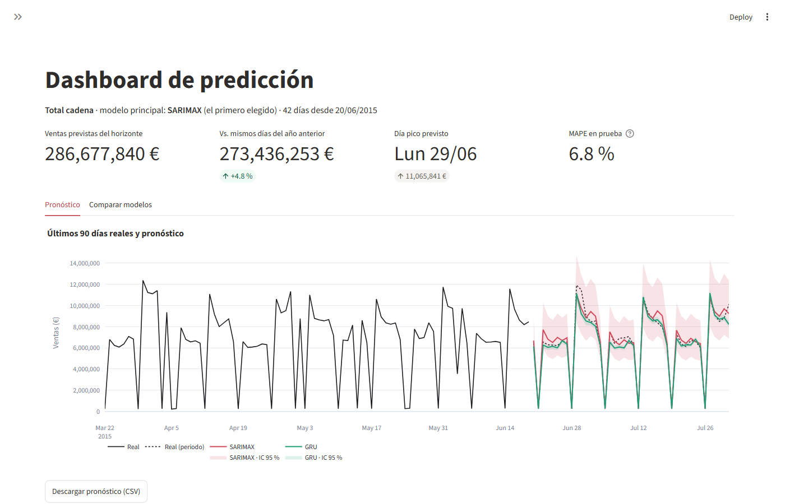
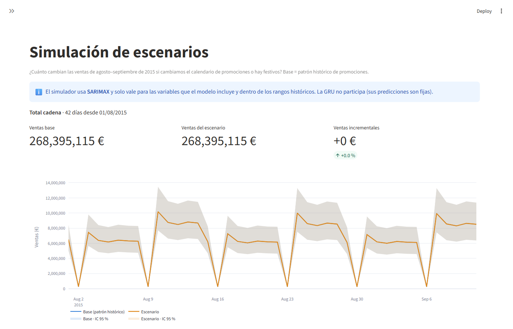
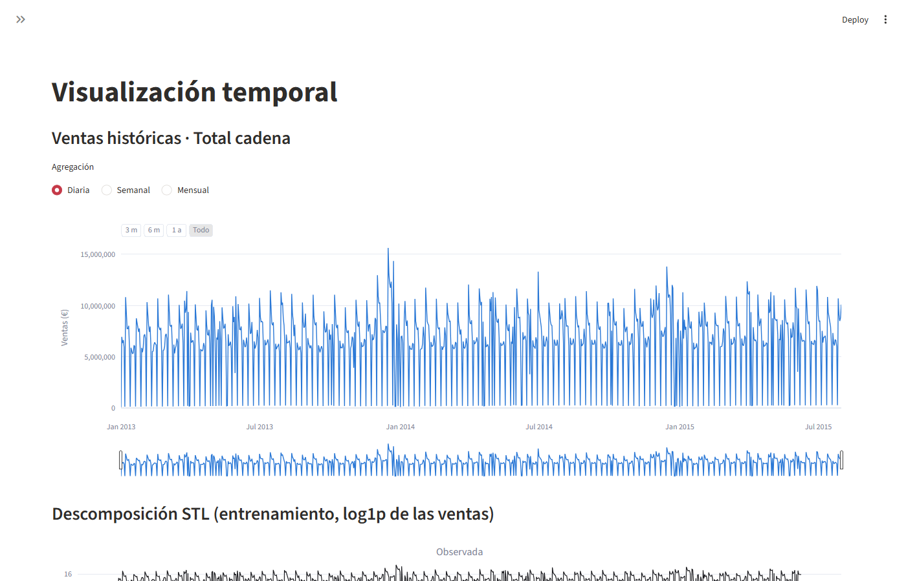

# Rossmann: predicción de demanda con SARIMAX y GRU

Proyecto final de Inteligencia de Minería de Datos. Pronostica las ventas diarias de Rossmann
(Kaggle *Rossmann Store Sales*) para los próximos **42 días** a nivel total, por tipo de tienda
(StoreType a–d) y para 5 tiendas seleccionadas. Incluye una app web con dashboard de predicción,
simulación de escenarios de promoción y visualización temporal. Metodología: **CRISP-DM**.

- **App pública:** <https://rossmangit-ughzxfhwlvjsef8qgxdi3e.streamlit.app/> (Streamlit Community
  Cloud; si estuvo inactiva, tarda unos segundos en despertar)
- **Objetivo SMART:** superar al baseline ingenuo estacional con **MAPE < 15 %** en el periodo
  de prueba. ✅ Cumplido por SARIMAX en los 10 niveles y por la GRU en `total`.

## Metodología y resultados

**Metodología.** Seguimos CRISP-DM con datos de Rossmann, de enero de 2013 a julio de 2015. Limpiamos
el hueco de 180 tiendas en 2014 sin usar información futura y separamos los datos por tiempo:
entrenamiento, validación y prueba, estos dos últimos de 42 días cada uno.

Comparamos un baseline que repite la última semana, SARIMA, SARIMAX y una red GRU. SARIMAX usa la
estacionalidad semanal, términos anuales de Fourier y variables conocidas de antemano: promociones,
aperturas y festivos. Nunca usa el número de clientes, porque no se conoce al pronosticar. Los órdenes
se eligieron solo con validación y la prueba se usó una vez.

**Resultados.** SARIMAX supera al baseline y logra un MAPE menor a 15 % en los 10 niveles evaluados. En
la venta total, el MAPE es 6,8 % frente a 17,4 % del baseline. La GRU logra 5,5 % en el total, pero su
diferencia con SARIMAX no es estadísticamente significativa (Wilcoxon, p = 0,29). El periodo de prueba
no incluye festivos, y en validación los tipos a y d quedaron en 19,0 % y 17,5 %.

**Cómo leer el simulador.** La promoción se asocia con cerca de 39 % más venta en el total, y el efecto
varía por tipo y tienda. Es una estimación histórica: no prueba causalidad ni considera costos o margen.
Los datos terminan el 31/07/2015.

El informe completo de datos, estacionalidad, modelos estadísticos y evaluación está en
[`docs/INFORME_PERSONA_A.md`](docs/INFORME_PERSONA_A.md).

## Capturas

| Dashboard | Escenarios | Series |
| --- | --- | --- |
|  |  |  |

## Datos y partición

`train.csv` y `store.csv` de Kaggle (2013-01-01 a 2015-07-31). La partición es temporal y nunca
aleatoria (fechas en `src/config.py`):

| Periodo | Fechas | Uso |
| --- | --- | --- |
| Entrenamiento | 2013-01-01 → 2015-05-08 | ajuste de modelos y escaladores |
| Validación | 2015-05-09 → 2015-06-19 (42 días) | elegir órdenes, variantes y épocas |
| Prueba | 2015-06-20 → 2015-07-31 (42 días) | evaluación final, **usada una sola vez** |
| Futuro | 2015-08-01 → 2015-09-11 (42 días) | pronóstico de la app y simulador |

Reglas: `Customers` no se usa como exógena (fuga de datos), el MAPE se calcula solo sobre días
con venta > 0 y todo modelo se compara contra el baseline ingenuo estacional (`y(t − 7)`).

## Modelos

| Modelo | Descripción |
| --- | --- |
| `naive` | ingenuo estacional: repite la última semana conocida |
| `sarima` | SARIMA sobre `log1p(y)`, s = 7; órdenes por AIC + RMSE de validación |
| `sarimax` | SARIMA + exógenas (promo, apertura, festivos, Promo2 y Fourier anual); alimenta el simulador |
| `gru` | codificador–decodificador GRU, 56 días pasados → 42 futuros con exógenas conocidas (D-13) |

## Métricas finales (prueba)

Nivel `total`:

| Modelo | RMSE | MAE | MAPE |
| --- | --- | --- | --- |
| naive | 1 775 080 | 1 179 019 | 17,4 % |
| sarima | 1 734 123 | 1 228 501 | 17,1 % |
| sarimax | **571 130** | 409 097 | 6,8 % |
| gru | 580 806 | **354 428** | **5,5 %** |

MAPE (%) por nivel. La GRU se entrenó solo para `total`:

| Nivel | naive | sarima | sarimax | gru |
| --- | --- | --- | --- | --- |
| total | 17,4 | 17,1 | **6,8** | **5,5** |
| type_a | 18,7 | 22,3 | **13,7** | — |
| type_b | 9,8 | 8,5 | **3,5** | — |
| type_c | 19,6 | 33,4 | **9,3** | — |
| type_d | 20,7 | 19,9 | **11,2** | — |
| store_9 | 22,2 | 36,1 | **10,0** | — |
| store_769 | 10,1 | 11,1 | **7,7** | — |
| store_504 | 15,7 | 25,3 | **10,6** | — |
| store_960 | 28,8 | 29,8 | **8,5** | — |
| store_693 | 58,3 | 30,6 | **10,5** | — |

Prueba de Wilcoxon sobre los errores absolutos diarios en `total`:
- SARIMAX vs naive: p = 0,003, SARIMAX es significativamente mejor.
- SARIMAX vs GRU: p = 0,29, sin diferencia significativa.

El detalle está en `artifacts/metrics/`.

## Cómo reproducir

Requiere Python 3.11 o superior y credenciales de Kaggle, con las reglas de la competencia aceptadas.

```bash
python -m venv .venv && source .venv/bin/activate   # Windows: .venv\Scripts\activate
pip install -r requirements.txt                      # entorno de entrenamiento

python -m src.data.make_dataset      # descarga y limpia → data/processed/rossmann.parquet
python -m src.features.exog          # series agregadas → artifacts/series/history.parquet
python -m src.models.baseline        # → forecasts/naive.parquet, metrics/naive.json
python -m src.models.arima select    # elige órdenes SARIMA/SARIMAX solo con train + val
python -m src.models.arima final     # → sarima/sarimax + models/sarimax_*.pkl
# notebooks/05_gru.ipynb             # → forecasts/gru.parquet, metrics/gru.json
python -m src.evaluation.compare     # → metrics/comparison.json (tabla final y Wilcoxon)

pip install -r app/requirements.txt
streamlit run app/Home.py
```

Los notebooks `01_eda` y `02_estacionalidad` documentan el análisis exploratorio y la
estacionalidad. Sin artifacts reales, la app genera datos de prueba con el mismo esquema
(`app/mock_data.py`).

> `app/requirements.txt` fija `pandas`, `numpy` y `statsmodels` en las versiones con las que se
> guardaron los `sarimax_*.pkl` (D-12). Si se regeneran los modelos con otras versiones, hay que
> actualizar las tres juntas.

## Estructura

| Ruta | Contenido | Dueño |
| --- | --- | --- |
| `src/data`, `src/features` | carga, limpieza, series agregadas y exógenas | A |
| `src/models/baseline.py`, `arima.py` | baseline ingenuo estacional, SARIMA/SARIMAX | A |
| `src/models/gru.py`, `notebooks/05_gru.ipynb` | modelo GRU | B |
| `src/evaluation` | métricas (RMSE, MAE, MAPE), backtest y comparación final | A |
| `notebooks/01–02` | EDA y análisis de estacionalidad | A |
| `artifacts/` | pronósticos, métricas y modelos que lee la app | A y B |
| `app/` | aplicación Streamlit (Inicio, Dashboard, Escenarios, Series) | B |
| `docs/` | contrato de datos, decisiones (D-xx), propuestas (P-xx) y guías | compartido |

## Calidad

```bash
ruff check . && black --check . && pytest -q -m "not slow"
```

La CI de GitHub Actions corre lo mismo en cada push y PR. `main` está protegida: solo recibe
cambios por PR y con la CI en verde.

## Limitaciones

- Los datos llegan hasta 2015 y no incluyen clima ni precios.
- El simulador usa SARIMAX, que es lineal en log. Solo vale para las variables que incluye el
  modelo y dentro de los rangos históricos. La GRU no participa del simulador.
- El intervalo de la GRU (MC Dropout) es muy estrecho y no debe leerse como un 95 % calibrado.
